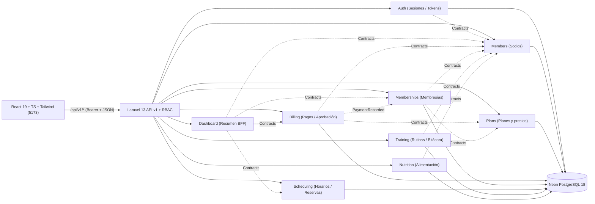

# LOBO — Club de Entrenamiento

Plataforma web para la administración operativa de un gimnasio (**LOBO — Club de Entrenamiento**), construida bajo arquitectura **Monolito Modular** con Laravel 13 y PHP 8.5 para la API REST (`/api/v1/*`) y una aplicación SPA moderna en React 19, TypeScript, Tailwind CSS v4 y TanStack Query v5.

---

## Arquitectura y flujo de datos

El backend organiza el dominio en 10 contextos acotados independientes bajo `backend/modules/<Modulo>` (`Shared`, `Auth`, `Members`, `Plans`, `Billing`, `Memberships`, `Scheduling`, `Training`, `Nutrition`, `Dashboard`). Cada módulo separa estrictamente `Presentation -> Application -> Domain <- Infrastructure`. Ningún módulo importa modelos Eloquent, repositorios o lógica interna de sus pares; la colaboración entre contextos ocurre únicamente mediante interfaces en `Contracts/` y eventos de dominio (`PaymentRecorded`), verificada automáticamente en `ModularBoundariesTest.php`.



### Reglas de fronteras modulares verificadas (`ModularBoundariesTest.php`)
- Todo código bajo `Modules\` declara `declare(strict_types=1);`.
- `Shared` no depende de ningún módulo de dominio.
- `Auth` consume únicamente `Contracts\` de `Members`.
- `Members`, `Plans` y `Scheduling` no dependen de ningún otro módulo de negocio.
- `Billing` consume únicamente `Contracts\` de `Members` y `Plans` (nunca `Domain\`, `Application\`, `Infrastructure\` ni `Presentation\`).
- `Memberships` consume únicamente `Contracts\` de `Members`, `Plans` y `Billing`.
- `Training` y `Nutrition` consumen únicamente `Contracts\` de `Members`.
- `Dashboard` consume únicamente `Contracts\` de `Members`, `Billing`, `Memberships` y `Scheduling`.
- Los controladores no acceden a `DB::` ni a modelos Eloquent directamente; delegan en `Application\Services` y `FormRequest::toDto()`.

---

## Stack tecnológico

| Capa | Tecnología | Versión |
| --- | --- | --- |
| Lenguaje backend | PHP (`strict_types`, `readonly`, `clone with`, pipe operator `\|>`, `#[NoDiscard]`) | `8.5.12` |
| Framework backend | Laravel (`laravel/laravel` / `laravel/framework`) | `13.11.0` / `13.44.1` |
| Base de datos | PostgreSQL | `18.6` |
| Testing backend | Pest (`pestphp/pest` + `pestphp/pest-plugin-laravel` + Arch plugin) | `5.3.7` / `5.0.1` |
| Análisis estático | Larastan (`larastan/larastan` + PHPStan nivel 8) | `3.15.0` |
| Formateador PHP | Laravel Pint | `1.32.3` |
| Frontend | React + TypeScript + Vite + Tailwind CSS v4 + TanStack Query + React Router + Lucide | `React 19.2` / `TS 6.0` / `Vite 8.3` / `TW 4.2` |
| Testing frontend | Vitest + Testing Library + jsdom | `Vitest 4.1` |
| Runtime frontend | Node.js / npm | `24.21.0` / `12.2.1` |

---

## Estructura del repositorio

```text
.
├── backend/                          # Monolito Modular en Laravel 13 (API /api/v1/*)
│   ├── bootstrap/                    # Registro modular (providers.php) y mapeo JSON global de errores (app.php)
│   ├── database/seeders/             # Seeder inicial (planes MXN, 4 disciplinas y grilla Lunes-Sábado)
│   ├── modules/
│   │   ├── Shared/                   # Money (MXN), GymOperatingHours, DomainException, RequestActorResolver, /healthz
│   │   ├── Auth/                     # Autenticación Bearer (users.role, api_tokens), RBAC y login/registro por rol
│   │   ├── Members/                  # Socios (CRUD, email opcional, alta/enlace por email o nombre, conteo activos)
│   │   ├── Plans/                    # Planes y precios (tagline, features, is_featured, precios en centavos)
│   │   ├── Billing/                  # Ingresos por socio (pagos, solicitudes pending, aprobación/rechazo, PaymentRecorded)
│   │   ├── Memberships/              # Membresías con vigencia (alta/renovación/pausa/cancelación y activación por pago)
│   │   ├── Scheduling/               # Entrenamientos, horarios (Lun-Sáb) y reservas por socio (class_bookings)
│   │   ├── Training/                 # Rutinas con ejercicios por día y bitácora de sesiones completadas (workout_logs)
│   │   ├── Nutrition/                # Planes alimenticios, metas calóricas/macros y comidas por tiempo diario
│   │   └── Dashboard/                # Read model BFF (/api/v1/dashboard/summary)
│   └── tests/Architecture/           # Reglas ejecutables Pest Arch
├── frontend/                         # SPA React 19 + TypeScript + Tailwind CSS v4
│   ├── public/images/                # Recursos fotográficos locales (hero y 4 entrenamientos)
│   └── src/
│       ├── app/                      # Enrutador protegido por rol, QueryClient y AppShell (Admin vs Portal Socio)
│       ├── features/                 # auth, member-portal, dashboard, billing, members, schedule, plans, routines, workouts, nutrition
│       ├── shared/                   # Cliente HTTP tipado, KpiCard, AssignMemberModal, ToastContext y formateadores MXN/fechas
│       └── tests/                    # Pruebas Vitest + Testing Library
├── .env.example                      # Plantilla raíz sincronizada de variables de entorno
├── LICENSE                           # Licencia MIT
└── package.json                      # Scripts unificados del monorepo
```

---

## Requisitos previos

- **PHP >= 8.5** con extensiones `pdo_pgsql`, `pgsql`, `mbstring`, `openssl`, `curl`, `xml`, `dom`, `zip`, `ctype`, `tokenizer`, `fileinfo`.
- **Composer >= 2.x**
- **PostgreSQL >= 18** en ejecución local con bases de datos `lobo` y `lobo_test`.
- **Node.js >= 24.x** y **npm >= 12.x** para el frontend.

---

## Variables de entorno

Plantillas sincronizadas en [`.env.example`](file:///home/omicron/Documentos/gym/.env.example) y [`backend/.env.example`](file:///home/omicron/Documentos/gym/backend/.env.example):

| Variable | Tipo | Obligatoria | Descripción | Valor de ejemplo seguro |
| --- | --- | --- | --- | --- |
| `VITE_API_PROXY_TARGET` | `string` | No | URL destino del proxy `/api` en desarrollo Vite | `http://127.0.0.1:8000` |
| `APP_NAME` | `string` | Sí | Nombre de la aplicación Laravel | `LOBO` |
| `APP_ENV` | `string` | Sí | Entorno de ejecución (`local`, `testing`, `production`) | `local` |
| `APP_KEY` | `string` | Sí | Clave de cifrado generada con `php artisan key:generate` | `` |
| `APP_DEBUG` | `boolean` | Sí | Habilita o deshabilita detalle de depuración | `true` |
| `APP_URL` | `string` | Sí | URL base pública del backend | `http://127.0.0.1:8000` |
| `APP_LOCALE` | `string` | No | Idioma principal de la aplicación | `es` |
| `APP_FALLBACK_LOCALE` | `string` | No | Idioma de respaldo | `en` |
| `APP_FAKER_LOCALE` | `string` | No | Locale para generación de datos de prueba | `es_ES` |
| `APP_MAINTENANCE_DRIVER` | `string` | No | Driver para modo mantenimiento | `file` |
| `BCRYPT_ROUNDS` | `integer` | No | Costo de hashing Bcrypt | `12` |
| `LOG_CHANNEL` | `string` | No | Canal principal de logs | `stack` |
| `LOG_STACK` | `string` | No | Canales agregados en stack | `single` |
| `LOG_DEPRECATIONS_CHANNEL` | `string` | No | Canal para advertencias de deprecación | `null` |
| `LOG_LEVEL` | `string` | No | Nivel mínimo de registro de logs | `debug` |
| `DB_CONNECTION` | `string` | Sí | Driver de base de datos Laravel | `pgsql` |
| `DB_HOST` | `string` | Sí | Host del servidor PostgreSQL | `127.0.0.1` |
| `DB_PORT` | `integer` | Sí | Puerto del servidor PostgreSQL | `5432` |
| `DB_DATABASE` | `string` | Sí | Nombre de la base de datos | `lobo` |
| `DB_USERNAME` | `string` | Sí | Usuario de conexión a PostgreSQL | `postgres` |
| `DB_PASSWORD` | `string` | Sí | Contraseña del usuario de base de datos | `change_me_in_local_env` |
| `DB_SSLMODE` | `string` | No | Modo TLS (`prefer` en local, `require` en Neon/cloud) | `prefer` |
| `SESSION_DRIVER` | `string` | No | Driver de sesiones HTTP | `array` |
| `SESSION_LIFETIME` | `integer` | No | Duración de sesión en minutos | `120` |
| `SESSION_ENCRYPT` | `boolean` | No | Cifrado de payload de sesión | `false` |
| `SESSION_PATH` | `string` | No | Ruta base de cookie de sesión | `/` |
| `SESSION_DOMAIN` | `string` | No | Dominio de cookie de sesión | `null` |
| `BROADCAST_CONNECTION` | `string` | No | Driver de broadcasting | `log` |
| `FILESYSTEM_DISK` | `string` | No | Disco por defecto de almacenamiento | `local` |
| `QUEUE_CONNECTION` | `string` | No | Driver de colas | `sync` |
| `CACHE_STORE` | `string` | No | Almacén de caché | `array` |
| `MAIL_MAILER` | `string` | No | Driver de correo | `log` |
| `MAIL_FROM_ADDRESS` | `string` | No | Dirección remitente por defecto | `noreply@example.com` |
| `MAIL_FROM_NAME` | `string` | No | Nombre remitente por defecto | `${APP_NAME}` |
| `LOBO_DEMO_LOGIN_ENABLED` | `boolean` | No | Habilita botones de acceso demo en entornos `local`/`testing` | `true` |
| `LOBO_DEMO_ADMIN_EMAIL` | `string` | No | Correo de cuenta administrativa sembrada en desarrollo | `admin@loboclub.com` |
| `LOBO_DEMO_ADMIN_PASSWORD` | `string` | No | Contraseña local para administrador sembrado | `change_me_admin` |
| `LOBO_DEMO_MEMBER_EMAIL` | `string` | No | Correo de socio sembrado en desarrollo | `alex.rivera@loboclub.com` |
| `LOBO_DEMO_MEMBER_PASSWORD` | `string` | No | Contraseña local para socio sembrado | `change_me_member` |

---

## Instalación y ejecución

### Desarrollo

1. Clonar el repositorio e instalar dependencias:

```bash
git clone https://github.com/santiagolobosilva20-cmd/LOBO.git
cd LOBO
composer --working-dir=backend install
npm --prefix frontend install
```

2. Configurar variables de entorno y generar clave de aplicación:

```bash
cp backend/.env.example backend/.env
php backend/artisan key:generate
```

3. Crear bases de datos PostgreSQL (`lobo` y `lobo_test` en instancia local o en **Neon Serverless Postgres** con `DB_SSLMODE=require`), migrar y sembrar el catálogo base (`Pase diario $120`, `Mensualidad $890`, `Trimestral $2,350`, 4 disciplinas y horarios `Lunes`–`Sábado`):

```bash
# En PostgreSQL local (omitir si ya existen las bases en Neon):
createdb -U postgres lobo
createdb -U postgres lobo_test

php backend/artisan migrate --seed
```

4. Levantar backend y frontend en terminales separadas:

```bash
npm run dev:backend
npm run dev:frontend
```

### Producción

```bash
composer --working-dir=backend install --no-dev --optimize-autoloader
php backend/artisan config:cache
php backend/artisan route:cache
php backend/artisan migrate --force
npm --prefix frontend ci
npm run build:frontend
```

---

## Uso, contratos y endpoints principales

Todos los endpoints residen bajo `/api/v1` y devuelven respuestas JSON tipadas (`data`/`meta` en éxito y `error.{code,message,errors,timestamp}` en fallo). Los importes se expresan en centavos enteros (`MXN`).

| Método | Ruta | Módulo | Descripción | Payloads / Parámetros clave | Respuestas |
| --- | --- | --- | --- | --- | --- |
| `GET` | `/api/v1/healthz` | `Shared` | Estado de API y sonda real `SELECT 1` en BD | N/A | `200`, `503` |
| `GET/POST` | `/api/v1/auth/{config\|login\|register\|demo-login}` | `Auth` | Inicio de sesión, alta de socio (`role=member`) y config demo | `{"email":"...","password":"..."}` | `200`, `201`, `401`, `409` |
| `GET/POST` | `/api/v1/auth/{me\|logout}` | `Auth` | Perfil autenticado actual y revocación del token Bearer | Header `Authorization: Bearer ...` | `200`, `204`, `401` |
| `GET` | `/api/v1/dashboard/summary` | `Dashboard` | KPIs del mes, próxima clase, últimos pagos y clases destacadas (solo `admin`) | N/A | `200`, `403` |
| `GET/POST` | `/api/v1/payments/{id}/{approve\|reject}` | `Billing` | Aprobación (dispara `PaymentRecorded`) o rechazo de pagos en revisión (`admin`) | N/A | `200`, `403`, `409` |
| `GET/POST` | `/api/v1/member/{memberships\|payments\|payment-requests}` | `Memberships` / `Billing` | Membresía activa, historial propio y solicitud de pago pendiente (`member`) | `{"plan_id":2,"payment_method":"transfer"}` | `200`, `201`, `403` |
| `GET/POST/DELETE` | `/api/v1/member/schedule/sessions[/{id}/book]` | `Scheduling` | Horarios con reservas propias, reserva atómica y cancelación de cupo (`member`) | N/A | `200`, `409`, `403` |
| `GET/POST/DELETE` | `/api/v1/member/{routines\|workout-logs\|nutrition/plans}` | `Training` / `Nutrition` | Rutina y alimentación del socio + bitácora personal verificando autoría | `scope=mine\|templates` | `200`, `201`, `204`, `403` |
| `GET` | `/api/v1/members` | `Members` | Listado paginado de socios | `?search=&status=&page=&per_page=` | `200` |
| `POST` | `/api/v1/members` | `Members` | Alta de socio (`email` opcional) | `{"full_name":"Alex Rivera","status":"active"}` | `201`, `422`, `409` |
| `GET/PATCH/DELETE` | `/api/v1/members/{memberId}` | `Members` | Consulta, edición parcial y baja | Campos opcionales de socio | `200`, `204`, `404`, `409` |
| `GET/POST` | `/api/v1/plans` | `Plans` | Catálogo de planes (`tagline`, `features`, `is_featured`) | `{"name":"Mensualidad","price_cents":89000,"duration_days":30}` | `200`, `201`, `422`, `409` |
| `GET/PATCH/DELETE` | `/api/v1/plans/{planId}` | `Plans` | Consulta, edición/activación y borrado | Campos opcionales de plan | `200`, `204`, `404`, `409` |
| `GET` | `/api/v1/payments` | `Billing` | Historial paginado más `stats` globales acumulados | `?search=&method=&month=YYYY-MM` | `200` |
| `POST` | `/api/v1/payments` | `Billing` | Registra ingreso y activa/extiende membresía (`PaymentRecorded`) | `{"member_name":"Alex Rivera","plan_id":2,"payment_method":"cash"}` | `201`, `422`, `404`, `409` |
| `DELETE` | `/api/v1/payments/{paymentId}` | `Billing` | Elimina un registro de ingreso | N/A | `204`, `404` |
| `GET/POST` | `/api/v1/memberships` | `Memberships` | Listado filtrado (`status`, `expiring_soon`), stats y alta manual | `{"member_name":"Alex Rivera","plan_id":2}` | `200`, `201`, `422`, `404` |
| `POST` | `/api/v1/memberships/{id}/{renew\|pause\|resume\|cancel}` | `Memberships` | Transiciones de vigencia y ciclo de vida | `{"plan_id":2}` (opcional en `renew`) | `200`, `404`, `409` |
| `GET/POST/PATCH/DELETE` | `/api/v1/workouts` | `Scheduling` | Catálogo de disciplinas (`badge_label`, `image_url`, `display_order`) | `{"name":"Fuerza funcional","category":"FUERZA"}` | `200`, `201`, `204`, `422`, `409` |
| `GET/POST/DELETE` | `/api/v1/schedule/sessions` | `Scheduling` | Sesiones por día (`day_of_week` 1..6), sala, hora y cupo | `{"workout_id":1,"day_of_week":1,"room":"Sala Norte",...}` | `200`, `201`, `204`, `422`, `404` |
| `POST` | `/api/v1/schedule/sessions/{sessionId}/enroll` | `Scheduling` | Reserva atómica de cupo con bloqueo `lockForUpdate` | N/A | `200`, `404`, `409` |
| `GET/POST/PATCH/DELETE` | `/api/v1/routines` | `Training` | Rutinas con ejercicios por día, series, reps, carga y descanso | `{"title":"Fuerza 4D","goal":"strength","exercises":[...]}` | `200`, `201`, `204`, `422`, `404` |
| `POST` | `/api/v1/routines/{routineId}/assign` | `Training` | Clona rutina plantilla para un socio específico | `{"member_name":"Alex Rivera"}` | `201`, `422`, `404` |
| `GET/POST/DELETE` | `/api/v1/workout-logs` | `Training` | Bitácora de entrenamientos realizados (duración, RPE, kcal) | `{"member_name":"Alex Rivera","title":"Fuerza","duration_minutes":45}` | `200`, `201`, `204`, `422` |
| `GET/POST/PATCH/DELETE` | `/api/v1/nutrition/plans` | `Nutrition` | Planes alimenticios (kcal, macros P/C/G, agua y comidas diarias) | `{"title":"Definición","goal":"fat_loss","daily_calories":1900,"meals":[...]}` | `200`, `201`, `204`, `422` |
| `POST` | `/api/v1/nutrition/plans/{planId}/assign` | `Nutrition` | Clona plan nutricional plantilla para un socio específico | `{"member_name":"Alex Rivera"}` | `201`, `422`, `404` |

---

## Scripts disponibles y suite de pruebas

Desde la raíz (`package.json`):

- `npm run dev:backend`: inicia Laravel en `127.0.0.1:8000`.
- `npm run dev:frontend`: inicia Vite en `127.0.0.1:5173` con proxy `/api`.
- `npm run typecheck:frontend`: valida tipos TypeScript con `tsc --noEmit`.
- `npm run test:frontend`: ejecuta la suite Vitest en `/frontend`.
- `npm run build:frontend`: valida tipos y construye el bundle de producción en `frontend/dist`.
- `npm run lint:backend`: verifica estilo PHP y `strict_types` con Pint (`--test`).
- `npm run analyse:backend`: ejecuta Larastan nivel 8.
- `npm run test:backend`: ejecuta `Architecture`, `Unit` y `Feature` en Pest 5.
- `npm run check:backend`: ejecuta en cadena `lint`, `analyse` y `test`.

Comandos directos de verificación en `backend/`:

```bash
cd backend
composer run lint
composer run analyse
php artisan test --testsuite=Architecture
php artisan test --testsuite=Unit
php artisan test --testsuite=Feature
php artisan test --coverage
```

---

## Despliegue y contenedores

Este repositorio aún no incluye `Dockerfile` ni `docker-compose.yml`. Para despliegue en servidor Linux con PHP-FPM 8.5 + Nginx + PostgreSQL 18:

1. Servir `backend/public` con PHP-FPM para rutas `/api/*` y `frontend/dist` como SPA estática desde Nginx con fallback a `index.html`.
2. Ejecutar `php backend/artisan migrate --force` antes de habilitar tráfico nuevo (criterio expand-and-contract).
3. Inyectar `APP_KEY` y `DB_PASSWORD` desde variables de entorno del sistema o gestor de secretos.

---

## Licencia y autoría

Distribuido bajo licencia MIT. Ver el archivo [`LICENSE`](file:///home/omicron/Documentos/gym/LICENSE).

Copyright (c) 2026 anthra123x
